  <a href="https://rzmrn.com">
    <picture>
      <source media="(max-width: 600px)" srcset="assets/header-compact.svg">
      
    </picture>
  </a>

I build AI systems that do real work: agent workflows that run production, models tuned and served for the job, and the evals that keep the output reliable. I work AI-native: I design the system, write the specs and tests, and direct the coding agents that write most of the code. Before AI I spent ten years in video production, so I know what good output looks like.

## Open source

  <a href="https://github.com/Beiev/max-chronicle">
    <picture>
      <source media="(max-width: 600px)" srcset="assets/card-chronicle-compact.svg">
      
    </picture>
  </a>

  <a href="https://github.com/Beiev/localflow">
    <picture>
      <source media="(max-width: 600px)" srcset="assets/card-localflow-compact.svg">
      
    </picture>
  </a>

## At work

AI & Automation Lead at the in-house AI studio of a creator-marketing agency. Agent swarms run most production stages under human quality gates, open-weight image and video models run self-hosted on cloud GPU fleets, and evals with A/B tests decide which model and settings ship. The numbers are in the [CV](https://rzmrn.com/en/cv).

## Toolbox

- **AI** — Claude Code, Codex, MCP, ComfyUI, LoRA / DoRA, MLX, CoreML, ONNX Runtime
- **Code** — Python, TypeScript, Swift, FastAPI, SQLite, Docker / CUDA, GitHub Actions
- **Craft** — video production, motion design, colour grading, multi-camera live

## Elsewhere

[rzmrn.com](https://rzmrn.com) · [LinkedIn](https://www.linkedin.com/in/maksym-beiev/) · [hello@rzmrn.com](mailto:hello@rzmrn.com)
